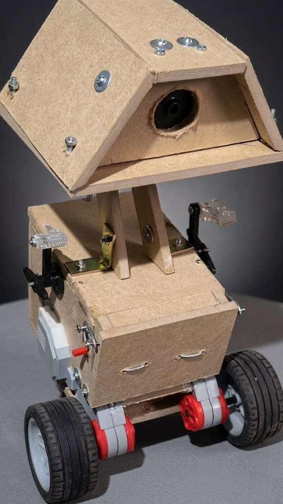
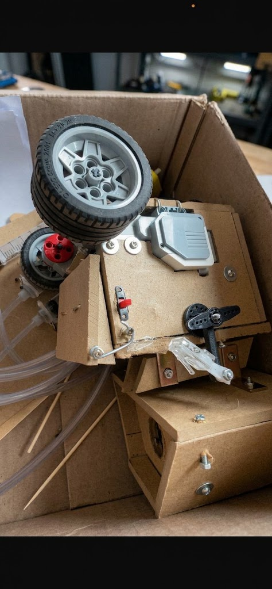

# 🤖 SAM - Robot Móvil ESP32 (WALL-E Edition) 📶⚡

Sistema de control inalámbrico avanzado para robot móvil utilizando un microcontrolador ESP32 y un puente H L298N Mini. Este diseño integra potentes **Motores Grandes LEGO Mindstorms EV3 (Ref: 45502)** adaptados mediante ingeniería inversa para su control de precisión. El proyecto genera un punto de acceso web local (`172.20.10.x`) con una interfaz gráfica optimizada para control táctil desde dispositivos móviles.

---

## 📑 **Tabla de Contenidos**
- ✨ Características Principales
- 📋 Lista de Materiales Detallada
- ⚙️ Integración de Motores LEGO EV3
- 🔌 Esquema de Conexiones
- 📸 Galería del Robot (WALL-E)
- 🚀 Instalación y Uso

---

## ✨ **Características Principales**
- **Interfaz UI/UX Embebida:** Tablero web almacenado directamente en la memoria PROGMEM del microcontrolador, sin necesidad de tarjetas SD ni servidores externos.
- **Protección Táctil Estricta:** Reglas CSS (`user-select: none;`, `-webkit-touch-callout: none;`) para evitar menús contextuales o selección de texto al mantener presionados los controles de dirección.
- **Conexión Directa M2M:** El ESP32 se enlaza directamente al "Punto de Acceso Personal" del teléfono móvil, eliminando la latencia y routers intermedios.
- **Tracción de Alta Potencia:** Uso adaptado de servomotores con retroalimentación tacométrica para desplazamiento preciso en línea recta.

---

## 📋 **Lista de Materiales Detallada**

### 🧠 Lógica y Control
- 🎛️ **1x** Placa de desarrollo ESP32 (WROOM-32, 30 o 38 pines).
- 🕹️ **1x** Módulo Driver de motor L298N Mini (MX1508).

### ⚡ Sistema de Alimentación
- 🔋 **1x** Batería cuadrada de 9V (Alternativa: 2x Baterías Li-ion 18650 con portapilas).
- 🔌 **1x** Conector/Broche para batería de 9V.
- 📉 **1x** Regulador de voltaje L7805CV (Para reducir los 9V a 5V limpios para el ESP32).
- 🔘 **1x** Interruptor (Switch) de encendido/apagado.

### ⚙️ Mecánica, Tracción y Actuadores
- 🏎️ **2x** **Motores Grandes LEGO Mindstorms EV3 (Ref: 45502)** adaptados al driver mediante ingeniería inversa.
- 🛞 **2x** Ruedas de tracción acopladas a los servomotores EV3.
- 🛹 **1x** Rueda loca omnidireccional o rueda libre pasiva para estabilidad estructural.

### 🛠️ Estructura y Cableado
- 🔗 Varios cables jumper (Macho-Macho y Macho-Hembra).
- 🏗️ Estructura física personalizada inspirada en el concepto WALL-E y diseño en MDF/Cartón reforzado.

---

## ⚙️ **Integración de Motores LEGO EV3 (Ref: 45502)**

| Característica Técnica | Especificación del Componente |
| :--- | :--- |
| **Tipo de Actuador** | Servomotor grande con retroalimentación tacométrica |
| **Velocidad Nominal** | 160 - 170 RPM |
| **Par de Funcionamiento** | 20 N.cm (~30 oz/in) |
| **Par de Parada (Stall Torque)** | 40 N.cm (~60 oz/in) |
| **Adaptación Electrónica** | Control mediante modulación PWM a través del driver L298N Mini |

> *Nota de Ingeniería:* Mediante ingeniería inversa se han adaptado las terminales de los motores inteligentes EV3 para ser gobernadas de forma eficiente con señales de potencia estándar del puente H.

---

## 📸 **Galería y Vistas del Proyecto**

| Vista Angular Completa (WALL-E) | Ensamblaje y Estructura Interna | Motor Grande LEGO EV3 |
| :---: | :---: | :---: |
|  |  |  |

---

## 📊 **Diagramas y Documentación Técnica**

El esquema completo de conexiones y la arquitectura electrónica del vehículo se pueden consultar en el documento oficial:
- 📄 [Descargar / Ver Diagrama de Conexiones (PDF)](hardware/diagrama_carro_movil.pdf)

---

## 🔌 **Esquema de Conexiones (Pinout)**

| Componente | Terminal | Conexión en ESP32 / Sistema |
| :---: | :---: | :--- |
| **Interruptor** | Pines | Intercalado en el cable positivo (+) entre la batería y el sistema |
| **L298N Mini** | IN1 | GPIO 16 |
| **L298N Mini** | IN2 | GPIO 17 |
| **L298N Mini** | IN3 | GPIO 18 |
| **L298N Mini** | IN4 | GPIO 19 |
| **L298N Mini** | VCC (+) | Batería 9V (+) (Después del interruptor) |
| **L298N Mini** | GND (-) | Batería 9V (-) Y GND común del ESP32 |
| **L298N Mini** | Motor A | Motor Derecho (EV3) |
| **L298N Mini** | Motor B | Motor Izquierdo (EV3) |
| **Regulador 7805** | Pin 1 (IN) | Batería 9V (+) (Después del interruptor) |
| **Regulador 7805** | Pin 2 (GND) | GND Común del sistema |
| **Regulador 7805** | Pin 3 (OUT) | Pin VIN o 5V del ESP32 |

---

## 🚀 **Instalación y Uso**

1. **Carga del Código:** Abre el archivo `src/walle_sam_web.ino` en el Arduino IDE y sube el firmware al ESP32 (Configurar velocidad del Monitor Serie a `115200` baudios).
2. **Red Móvil:** En tu celular, activa *Compartir internet* (Punto de acceso). Configura previamente el SSID como `iPhone` y la contraseña como `villanueva`.
3. **Sincronización de Hardware:** Enciende el robot desde el interruptor general. El LED azul interno (GPIO 2) parpadeará mientras establece enlace y se quedará fijo al conectar.
4. **Despliegue de Control:** Abre el navegador (Safari / Chrome) e ingresa a la IP asignada (`172.20.10.2` o `172.20.10.3`) para utilizar el panel de control.

---

 

### Samuel Elí Villanueva Chávez
**Tecnología, Informática y Telecomunicaciones (UNDAC)**

